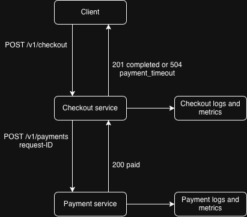

# CMPE 273 Lab 9 — Checkout and Payment Observability



- **Checkout** listens on `127.0.0.1:5000` and processes `POST /v1/checkout`.
- **Payment** listens on `127.0.0.1:5001` and handles `POST /v1/payments`.

Checkout calls Payment once per valid order, forwarding `X-Request-ID`. It uses
a 0.5-second connection timeout and a 0.5-second read timeout by default. These
are separate limits, rather than a single end-to-end deadline. Payment normally
responds immediately; the failure experiment delays its response by 1.5 seconds.
Payments are simulated and no money is charged.

## 1. Install dependencies

Use Python 3.9 or newer. 

```bash
python3 -m venv .venv
source .venv/bin/activate
python -m pip install -r requirements.txt
```

## 2. Run both services

In terminal 1:

```bash
source .venv/bin/activate
python payment.py 2>&1 | tee payment.log
```

In terminal 2:

```bash
source .venv/bin/activate
python checkout.py 2>&1 | tee checkout.log
```

If the default ports are occupied, use `python payment.py --port 5101` and
`PAYMENT_URL=http://127.0.0.1:5101 python checkout.py --port 5100`.
Set `PAYMENT_TIMEOUT_SECONDS` when starting Checkout to change its timeout
(greater than zero, at most five seconds).

## 3. Run the success, failure, and recovery demo

In terminal 3:

```bash
source .venv/bin/activate
python demo.py
```

For custom ports, pass `--checkout-url http://127.0.0.1:5100` and
`--payment-url http://127.0.0.1:5101`. Run the demo against idle services so its
before/after metrics are not affected by other traffic.

The demo verifies all three scenarios over real HTTP and exits unsuccessfully
if an expected status, request ID, metric change, or latency recovery is missing:

1. **Success:** Disable delay and submit an order. Payment returns `200 paid`;
   Checkout returns `201 completed`. The same request ID appears in both logs
   and in Checkout's response body and `X-Request-ID` response header.


2. **Failure:** Set Payment's delay to the Checkout timeout plus one second.
   Checkout returns `504` with `error: payment_timeout`. Health checks on both
   services still return `200`, and Checkout's failure counter increases.


3. **Recovery:** Reset delay to zero and let the outstanding Payment request
   finish. Submit three more orders. All return `201`, each with lower observed
   latency than the timed-out request, and Checkout's cumulative error rate falls.


On freshly started services, Checkout's metrics after failure show one success
and one failure: an error rate of `0.5`. After recovery they show four successes
and one failure: an error rate of `0.2`. Recovery requests usually take only a
few milliseconds locally, compared with about 500 ms for the timeout. Exact
latencies depend on the machine; the demo prints measured values.

## 4. Inspect observability

Every incoming request emits JSON `request_started` and `request_completed`
records with UTC timestamp, service, method, path, and request ID. Completion
records also include HTTP status, outcome, latency in milliseconds, and error.
Supply `X-Request-ID` to correlate a call; absent or invalid IDs are replaced
with a UUID. Accepted IDs contain 1–64 letters, digits, periods, underscores,
or hyphens.

For example, submit an identifiable successful order:

```bash
curl -i http://127.0.0.1:5000/v1/checkout \
  -H 'Content-Type: application/json' \
  -H 'X-Request-ID: checkout-example' \
  -d '{"order_id":"order-1","amount_cents":1000}'
```

Copy a `lab9-timeout-...` ID printed by the demo and find its log lines:

```bash
rg 'lab9-timeout-' checkout.log payment.log
```

Checkout's completion record shows `status: 504`, `outcome: failure`, and
`error: payment_timeout`. Payment logs the same ID on receipt and eventually
logs `status: 200` with a longer latency. **Checkout timing out does not cancel
Payment's work.** The demo intentionally preserves this distinction: Payment's
own success counter increases even though Checkout's request failed. No retries
are made, and this lab does not implement payment persistence or idempotency.

Inspect each service's counters and latency measurements:

```bash
curl -s http://127.0.0.1:5000/metrics | python -m json.tool
curl -s http://127.0.0.1:5001/metrics | python -m json.tool
```

Metrics include `request_count`, `success_count`, `failure_count`, `error_rate`,
`average_latency_ms`, and `last_latency_ms`. Only completed business POST
requests count; health, metrics, and delay controls are excluded. Responses with
status below 400 count as successes. Error rate is cumulative failures divided
by completed business requests. A historical failure and slow request remain
in the counters and average after recovery; use the new request logs and
`last_latency_ms` to observe current latency.

## 5. Manual failure and recovery

With both services running, introduce a delay longer than Checkout's timeout:

```bash
curl -s http://127.0.0.1:5001/admin/delay \
  -H 'Content-Type: application/json' -d '{"delay_seconds":1.5}'
curl -i http://127.0.0.1:5000/v1/checkout \
  -H 'Content-Type: application/json' -H 'X-Request-ID: manual-timeout' \
  -d '{"order_id":"order-slow","amount_cents":1000}'
curl -s http://127.0.0.1:5000/health
curl -s http://127.0.0.1:5001/health
```

Expect `504 payment_timeout` while both health checks still report `ok`.
Then remove the delay and submit another order:

```bash
curl -s http://127.0.0.1:5001/admin/delay \
  -H 'Content-Type: application/json' -d '{"delay_seconds":0}'
curl -i http://127.0.0.1:5000/v1/checkout \
  -H 'Content-Type: application/json' -H 'X-Request-ID: manual-recovery' \
  -d '{"order_id":"order-recovered","amount_cents":1000}'
```

Expect `201 completed`. Removing the delay affects new Payment requests;
requests already sleeping finish their original delay.

## 6. Reflection

Logs help diagnose failures by displaying what service did what, at what time. This helps developers find out what lines of code or what service may have contributed to a failure.
Traces help diagnose failures by linking services together, it shows how different services interact and in what part may have caused the failure. For example, a checkout service may encounter a timeout when sending requests to a payment service.
Metrics help diagnose failures by showing usage and load before leading to a failure. For example, memory usage of a service spiking to 98% before the service crashes.